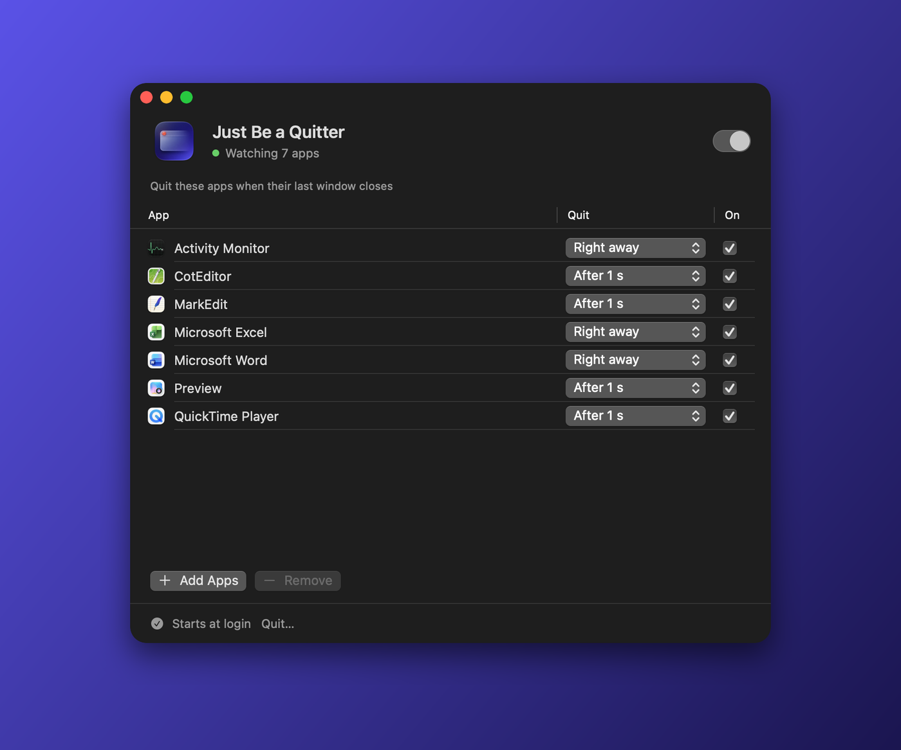

<p align="center">
  
</p>

<h1 align="center">Just Be a Quitter</h1>

<p align="center">
  Close the last window, and the app quits. Like it should.
</p>

<p align="center">
  <a href="https://github.com/Hankyone/just-be-a-quitter/releases/latest/download/Just-Be-a-Quitter.dmg"><b>Download for Mac</b></a> · macOS 15 or later
</p>

<p align="center">
  
</p>

On a Mac, closing an app's last window usually leaves the app running in the background. Just Be a Quitter fixes that for the apps you pick: close Preview's last PDF, and Preview quits.

## What it does

- **Quits the apps you choose** as soon as their last window closes, either right away or after a short delay.
- **Stays out of the way.** No Dock icon and no menu bar icon. It quietly runs in the background.
- **Always on.** Starts when you log in and restarts itself if it ever stops unexpectedly.
- **Plays it safe.** It won't quit an app that's still loading or busy, or one that still has a window on another desktop or in full screen.

Open the app from Spotlight or your Applications folder any time to add apps or change settings. On first launch, macOS will ask you to allow Accessibility access, which is how it sees when windows close.

## Install

1. [Download the DMG](https://github.com/Hankyone/just-be-a-quitter/releases/latest/download/Just-Be-a-Quitter.dmg), open it, and drag the app into Applications.
2. Open Just Be a Quitter and allow Accessibility access when asked.
3. Add the apps you want it to quit. That's it.

It's signed and notarized by Apple, so it opens without security warnings.

## Build from source

Requires Xcode.

```sh
./scripts/build-and-install.sh
```

## License

MIT
