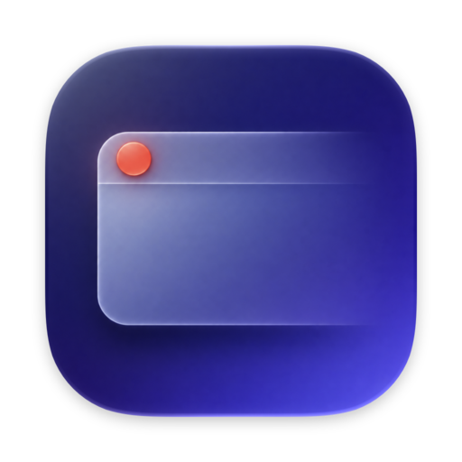

# Just Be a Quitter

A small macOS utility that quits the apps you choose as soon as you close their last window, the way they would on Windows.

- **Always on.** Starts at login and restarts itself if it ever crashes or gets killed. Choosing Quit keeps it off until you open it again or log back in.
- **Careful.** Only quits an app after it has had a window open. Never quits when an app is busy or not answering, and never while the app still has a window on another desktop (Space) or in full screen.
- **Light.** Sits idle in the background with no Dock icon or menu bar item, and does no UI work unless the settings window is open.
- **Per-app delay.** Quit right away, or wait 1 second to 1 minute.

Open the app any time (Spotlight or /Applications) to change settings. It needs Accessibility access to see windows.

## Build and install

```sh
./scripts/build-and-install.sh
```

Needs Xcode (for SwiftUI macros and `actool`), a code-signing identity (`SIGN_IDENTITY` to override), and the `trash` command. The script builds, signs, installs to `/Applications`, and restarts the background copy.

## How it works

- `BackgroundAgent.swift` registers a launchd agent bundled in the app (`Resources/com.hankyone.JustBeAQuitter.agent.plist`) with `KeepAlive` on crash only. A copy you launch by hand hands off to that agent and exits.
- `AppMonitorService.swift` watches tracked apps with Accessibility observers and quits an app when its window count drops to zero.
- `WindowServer.swift` double-checks with the window server before quitting, because Accessibility can't see windows on other Spaces.
- The icon is an Icon Composer file (`Resources/AppIcon.icon`), compiled by `actool` during the build.
